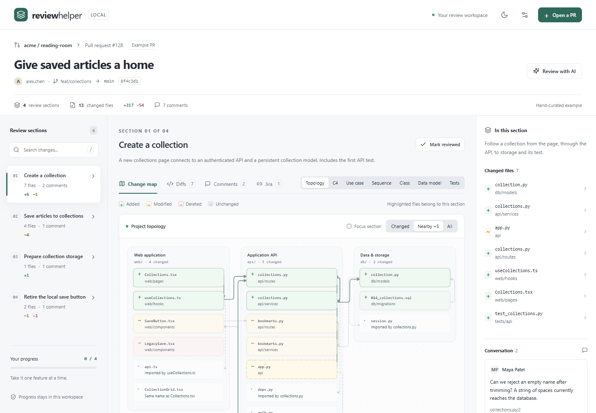
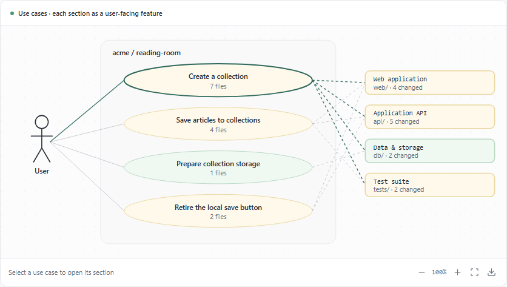
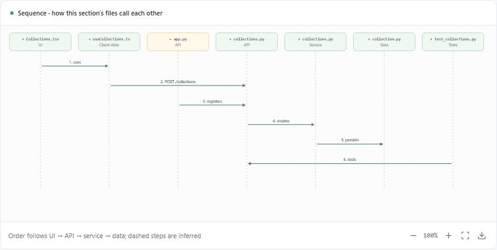
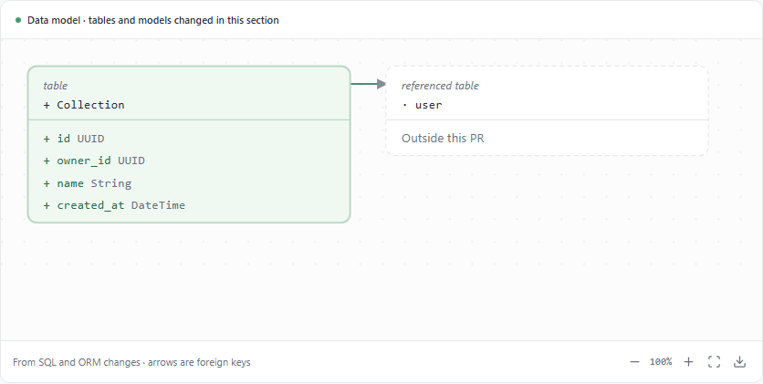
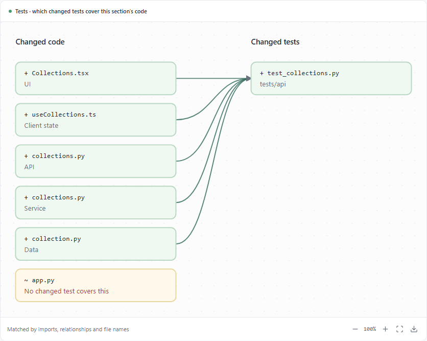
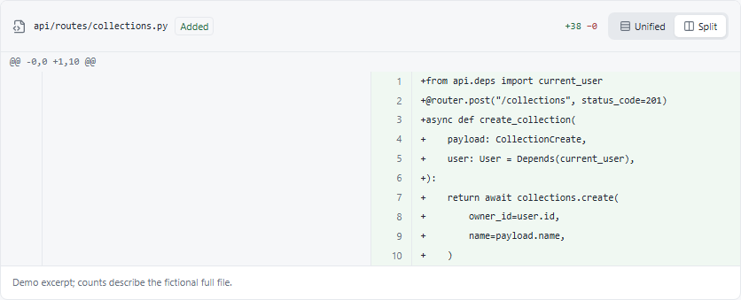
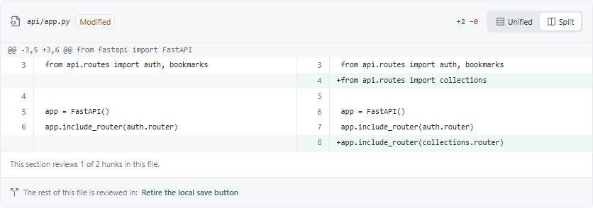
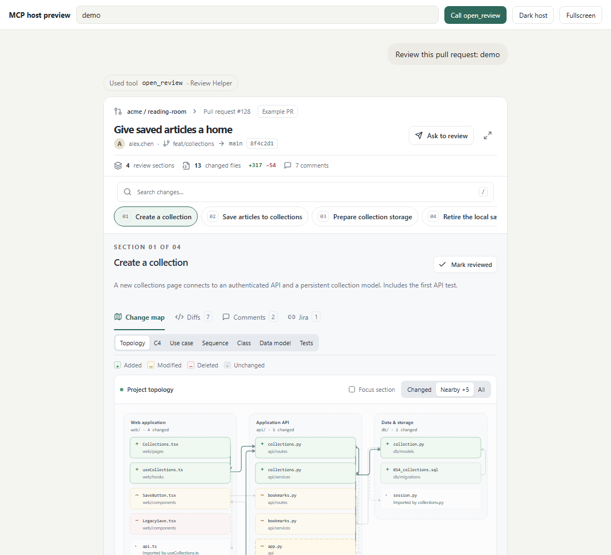
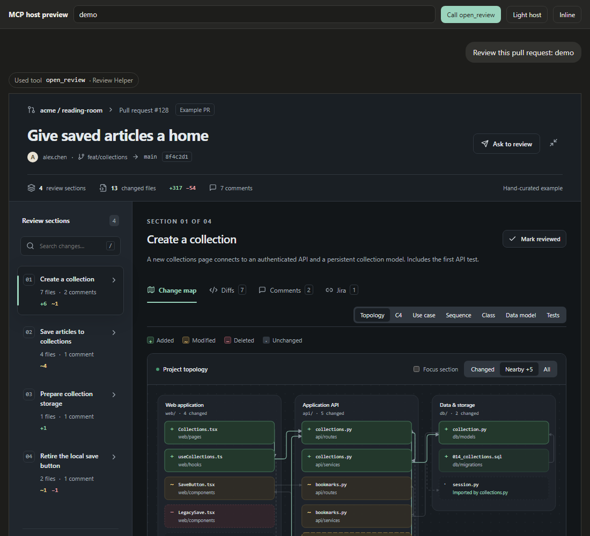

# Review Helper

**Review a pull request by feature, not by file.** Review Helper turns a GitHub, GitLab,
Bitbucket or Azure DevOps pull request into a few feature sections. Each section comes with
a map of the project that shows what was added, changed or deleted, plus the original diff
and the reviewers' comments. It runs as a web app and as an
[MCP App](https://github.com/modelcontextprotocol/ext-apps), so the same view opens inside
Claude, ChatGPT or any MCP host that supports apps.

[](https://github.com/antoinebou12/ReviewHelper/actions/workflows/ci.yml)
[](LICENSE)



> Open source, self-hosted and model-agnostic. The calling chat model does the reasoning;
> Review Helper needs no AI key of its own.

## Why

A flat list of 40 changed files hides the story of a pull request. Reviewers read files in
alphabetical order and tend to give the later ones less attention
([Rahman et al., 2026](https://arxiv.org/abs/2609.22610)). Review Helper groups the change by
behaviour instead. For example, one section can hold a new page, its API route, its database
table and its test. Within a section, files read foundations first. See
[docs/RESEARCH.md](docs/RESEARCH.md) for the papers and products behind these choices.

## Features

| | |
| --- | --- |
| **Feature sections** | Sections cross UI, API, data and tests. One file can be split **by hunk** across sections; each hunk has exactly one owner. |
| **Diagrams with content only** | Topology, C4 containers, use cases, sequence, class, data model (SQL/ORM) and a test map. A type appears only when the section has something to draw. |
| **Change colours** | Green added, yellow modified, red deleted, plus symbols and labels for colour-blind readers. |
| **Nearby files** | Unchanged files the change imports, links to or is named after. Each card says why it is shown. |
| **Original evidence** | Unified or side-by-side diffs, provider comments with safe Markdown, and linked Jira issues. |
| **Providers** | GitHub, GitLab, Bitbucket, Azure DevOps. Public URLs work without a token; private repos use tokens or GitHub / Microsoft Entra sign-in. |
| **MCP** | Tools, prompts, resources, a review skill, and an MCP App with a compact chat card and a fullscreen workspace. |
| **API** | REST with OpenAPI, Swagger UI at `/docs` and ReDoc at `/redoc`. |

<table>
<tr>
<td></td>
<td></td>
</tr>
<tr>
<td></td>
<td></td>
</tr>
<tr>
<td></td>
<td></td>
</tr>
</table>

### Inside a chat

The MCP App opens as a compact card with the map first. **Expand** asks the host for
fullscreen, and **Ask to review** posts a section-scoped request into the chat.

| Inline card | Fullscreen, dark host |
| --- | --- |
|  |  |

## Quick start

**Docker**

```bash
docker compose up --build
```

Open <http://127.0.0.1:8000>. The MCP endpoint is `http://127.0.0.1:8000/mcp/`.

**From source** (Python 3.12+, [uv](https://docs.astral.sh/uv/), Node 22)

```bash
uv sync --extra dev
npm ci && npm run build
uv run review-helper
```

The example pull request loads straight away. Choose **Open a PR** to paste a real URL, such
as `https://github.com/owner/repo/pull/123`.

## Use it from an MCP client

```json
{
  "mcpServers": {
    "review-helper": { "url": "http://127.0.0.1:8000/mcp/" }
  }
}
```

For stdio clients, use `uv run review-helper --stdio`. To see how a chat host embeds the app,
open <http://127.0.0.1:8000/mcp-preview>. [docs/MCP.md](docs/MCP.md) lists the tools,
resources and prompts.

## Private repositories

Set tokens in the server environment (see [.env.example](.env.example)). They never reach
the browser or the model.

| Provider | Token | Minimum access |
| --- | --- | --- |
| GitHub | `GITHUB_TOKEN`, or `GITHUB_CLIENT_ID` for sign-in | Fine-grained: Pull requests read, Contents read |
| GitLab | `GITLAB_TOKEN` | `read_api` (also needed for discussions on public projects) |
| Bitbucket | `BITBUCKET_TOKEN` and `BITBUCKET_EMAIL` | Repository and pull request read |
| Azure DevOps | `AZURE_DEVOPS_TOKEN`, or `AZURE_CLIENT_ID` for Entra sign-in | Code read |

Before you expose the server on a network, set `REVIEW_HELPER_ACCESS_TOKEN`.

## Deploy

Use Docker, [Vercel](https://vercel.com/docs/frameworks/backend/fastapi), or
[Manufact Cloud](https://manufact.com) for hosted MCP servers. See
[docs/DEPLOY.md](docs/DEPLOY.md).

## Quality

| Check | Command | Gate |
| --- | --- | --- |
| Unit + MCP protocol tests | `uv run pytest` | 85% line and branch coverage |
| End-to-end (web app and MCP App) | `npx playwright test` | all pass, axe accessibility checks |
| Mutation testing (review logic) | `uv run --extra mutation python scripts/mutation.py` | target 80% killed (reported, not yet blocking) |
| CRAP score | `uv run python scripts/quality_report.py --max-crap 30` | no function above 30 |
| MCP metadata lint | `uv run review-helper-lint` | all checks pass |
| Real providers | `REVIEW_HELPER_LIVE=1 uv run pytest -m live` | weekly in CI |

[docs/TESTING.md](docs/TESTING.md) explains each check.

## Project layout

```text
review_helper/   FastAPI app, MCP server, provider importers, hunk ownership, linter
ui/              React + TypeScript viewer (one bundle for the web app and the MCP App)
tests/           pytest: unit, API, MCP protocol, live providers
e2e/             Playwright: workspace, diagrams, MCP App host
docs/            Research notes, deployment, MCP and testing guides, screenshots
```

## Contributing

Issues and pull requests are welcome. Run the checks above before opening a PR.
[Renovate](https://docs.renovatebot.com/) keeps dependencies current, and
[CHANGELOG.md](CHANGELOG.md) records each release.

## License

[MIT](LICENSE) © 2026 Antoine Boucher. Review Helper is an independent project and is not
affiliated with CodeRabbit, GitHub, GitLab, Atlassian, Microsoft or Manufact.
